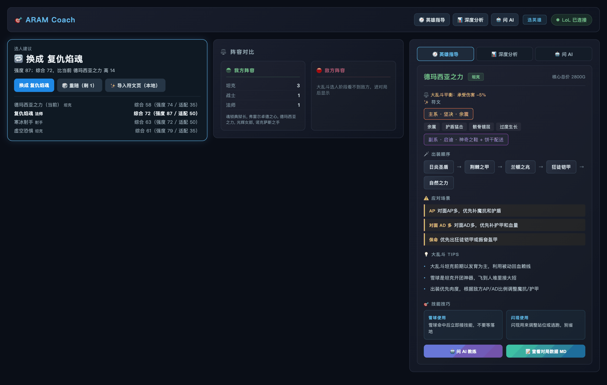
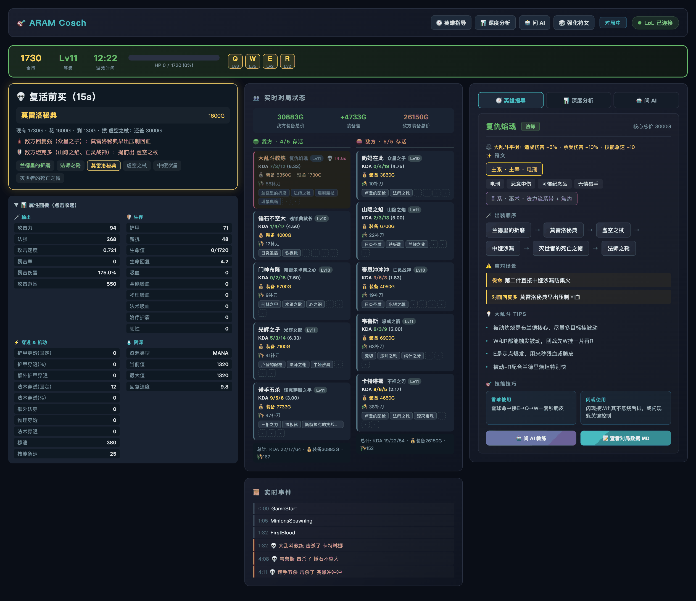
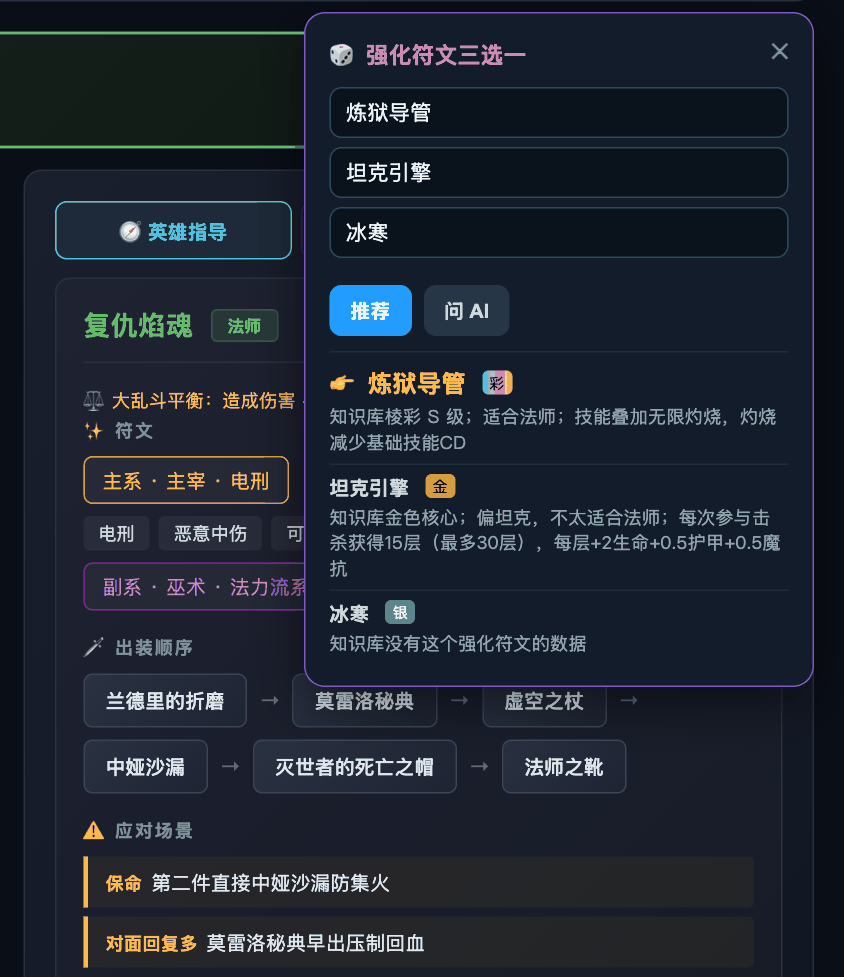
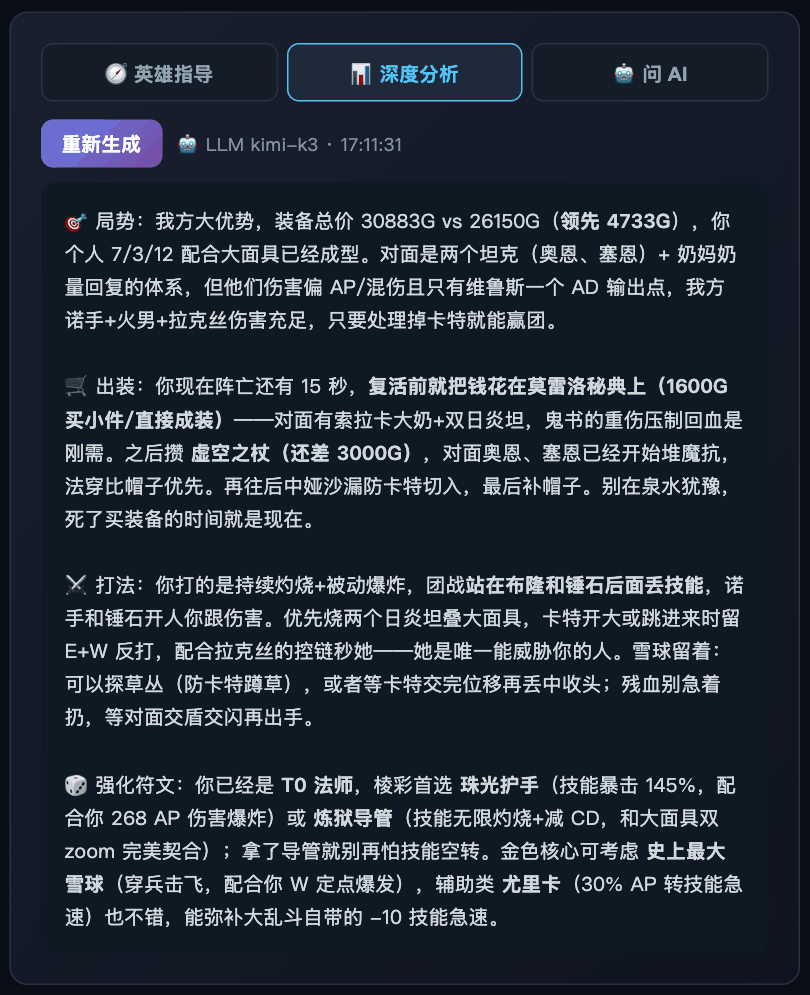
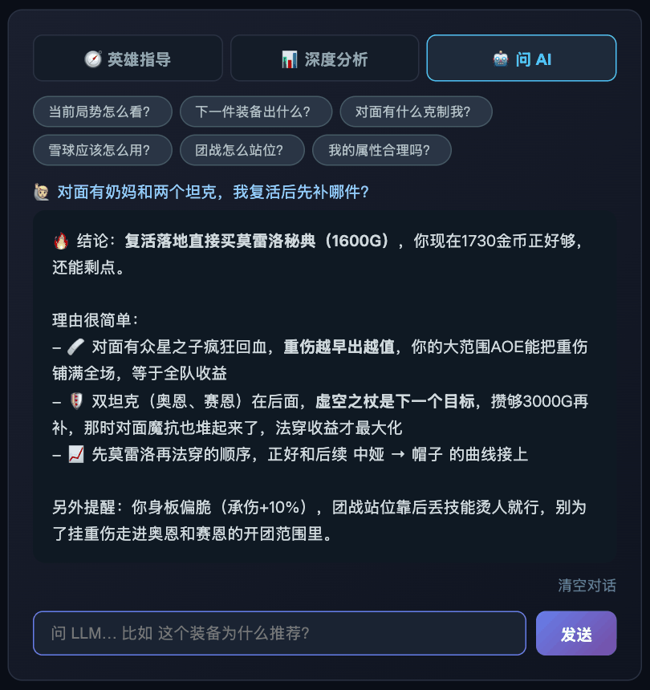

# ARAM Coach · 英雄联盟大乱斗实时 AI 教练

基于 **LCU（League Client API）** 与 **LCD（Live Client Data）** 的本地实时大乱斗教练。
读取游戏客户端数据，结合版本知识库与本地规则引擎（可选接入大模型），在选人、选装备、对线、团战各阶段给出可执行建议。

- 实时读取，无需截图、无需 OCR
- **只在三个决策时刻给明确答案**：选人（换 / 骰 / 留）、阵亡或开局（买什么）、升级（选哪个强化符文）；不刷泛泛的提示
- 大乱斗数据自动同步：OP.GG 大乱斗统计（梯度、胜率、出装、符文、召唤师技能、加点）+ 大乱斗平衡修正（造成/承受伤害、治疗、护盾等），拉不到时退回本地 170 名英雄数据
- 版本知识库驱动（海克斯大乱斗 `25.24_2025-12`）
- 双模式：配置了 API Key 时 AI 教练走 LLM（流式输出，可追问），未配置自动降级为本地规则引擎

---

## 界面预览

> 截图用的是模拟对局数据；AI 回答是 `kimi-k3` 的实际输出。

### 选人阶段：换 / 骰 / 留



左列直接给结论：这里随到盖伦，备选席上有火男，建议「换成 复仇焰魂」，下面列出每个候选英雄的综合分（强度 / 阵容适配）。点按钮就能换人、重随或把符文页写进客户端。中列是我方阵容构成，右列是当前英雄的符文、出装顺序、应对场景和技巧。

### 对局中：阵亡了买什么



阵亡后左上角弹出购物卡：按现有 1730G 算出复活前该买「莫雷洛秘典」（已有零件，补差价 1600G），并根据敌方阵容提前安排：对面有奶妈 → 重伤装，两个坦克 → 法穿装。顶部是金币、等级、游戏时间和技能等级；中列是双方实时战况（KDA、装备、估算经济差）和事件流；属性面板可展开查看完整属性。

### 强化符文三选一 · 深度分析 · 问 AI

| 强化符文三选一 | 深度分析 | 问 AI |
| :---: | :---: | :---: |
|  |  |  |
| 填入看到的三个选项，按知识库排序并说明理由；知识库没覆盖的不硬给结论，可以再点「问 AI」 | 一键生成整局分析：一句局势结论 + 最多三条行动，阵亡读秒内能看完；连着点会说比上次变了什么。未配置 Key 时走本地规则引擎 | 带本局上下文直接提问，回答只有几行，可追问；也有常用问题快捷按钮 |

---

## 目录

- [界面预览](#界面预览)
- [功能特性](#功能特性)
- [快速开始](#快速开始)
- [配置说明](#配置说明)
- [界面说明](#界面说明)
- [项目结构](#项目结构)
- [数据文件说明](#数据文件说明)
- [API 接口](#api-接口)
- [工作原理](#工作原理)
- [常见问题](#常见问题)
- [免责声明](#免责声明)

---

## 功能特性

### 选人阶段（ChampSelect）：换 / 骰 / 留

- **一句结论**：比较当前英雄、备选席（bench）上的每个英雄和"用骰子随一个"的期望，给出 `换成 X` / `用骰子重随` / `保留` 之一，并说明理由（OP.GG 梯度与胜率、是否补上阵容缺口）
- 综合分 = 乱斗强度 × 0.6 + 阵容适配 × 0.4；阵容适配会识别队伍缺前排 / 缺 AP / 缺持续输出，以及你是否正好补上
- **一键操作**：换成备选席英雄、重随、把推荐符文写进客户端
- **符文页导入**：建一个临时符文页（不占页位），之后原地改写它，从不删除任何符文页；有 OP.GG 数据用它的符文页（含属性碎片），否则把 `champions.json` 的符文名还原成符文页。可在配置里开启换英雄后自动导入

### 对局阶段（InProgress）：买什么

大乱斗不能回城，只有开局和阵亡时能买装备，所以对局里的核心是一张购物卡：

- **阵亡时**：按当前金币给出复活前要买的东西——买得起成装就买成装，买不起就挑一组总价最高的零件，并说明还差多少钱；装备栏满了会提示
- **开局**：有 OP.GG 出门装统计就照它买
- **活着时**：预告下次阵亡要买什么
- **针对敌方阵容提前装备**：敌方有回复型英雄 → 重伤装，坦克 ≥2 → 穿透装，前排遇到 AP/AD 为主的阵容 → 对应防装；按你的定位和出装是 AD 还是 AP 选具体装备，已经有了就不再提
- 价格和合成树来自 CommunityDragon 的当前版本数据；同名的斗魂竞技场变体装备会被排除
- 实时属性面板、双方实时战况（KDA、补刀、视野分、经济）、事件流照常显示
- **经济是估算值**：LCD 只给自己的金币，别人只看得到装备；而大乱斗只能阵亡时买，阵亡少的一方钱攒在身上，直接比装备总价会把优势方算少（落后时反而显示领先）。所以按人头 / 助攻 / 补刀 / 推塔估算每人挣到的钱，初始金币和被动收入这些大家都有的部分用你自己的真实金币（装备 + 现金 + 卖装备亏掉的）校准；赏金、终结和强化符文给的钱不计。常数用赛后逐分钟真实金币回归过（两局，团队经济差误差约 ±400G）
- **新英雄**：本地数据里还没有的英雄（没有定位），按他身上的装备判断 AP / AD，并告诉 AI 这是按装备判断的

### 强化符文三选一（海克斯大乱斗）

- 升到强化符文等级时自动弹出选择器（也可随时点右下角按钮打开），把看到的三个选项填进去（输入几个字即可筛选，符文池来自 CommunityDragon 的海克斯大乱斗列表）
- 按知识库排序：英雄专属推荐 > 知识库梯度 > 是否适合你的定位；知识库没覆盖的不硬给结论
- 配置了 LLM 时可以点"问 AI"，只返回三行：选哪个、为什么、拿了之后怎么调整
- LCD 接口拿不到当前给出的选项，所以需要手动填；弹出的等级默认 3/7/11/15，未经实机确认，可在配置里改

### 大乱斗数据同步

- 启动时若数据超过 24 小时未同步，后台自动拉取，完成后无需重启即生效；也可 `python update_data.py` 或 `POST /api/data/refresh` 手动刷新
- **OP.GG 大乱斗**：T 级与胜率（换算为乱斗强度）、最常见的出装与符文页、召唤师技能、加点顺序
- **Meraki（源自 LoL Wiki）**：每个英雄的大乱斗平衡修正，显示在英雄卡片并写入 AI 提示词
- **CommunityDragon**：符文、召唤师技能、装备的中文名，装备合成树与当前版本价格，海克斯大乱斗强化符文池
- 各数据源互相独立，失败时沿用上次结果；每个数据源单独判断是否过期，失败的下次启动会重试，成功的有效期内不重复下载；完全没有同步数据时使用 `champions.json` 和仓库里的静态快照
- 优先级：知识库（手写的版本专属数据）> OP.GG 统计 > `champions.json`；提示语（tips / 雪球 / 闪现技巧）始终来自 `champions.json`

### 事件流

- WebSocket 实时推送：阶段变化、骰子重随、升级、状态更新
- 每次状态轮询同步落盘 `game_state.md`（Markdown 快照），便于外部工具或 AI 直接读取

### 对局记录与复盘

AI 的回答和实际对不上时，用来查原因：是给 AI 的数据错了，还是 AI 自己说错了。每局一个目录 `game_logs/<开局时间>/`（已 gitignore）：

| 文件 | 内容 |
| --- | --- |
| `ai.jsonl` | 每次问 AI / 深度分析 / 强化符文：发给模型的完整消息、回答、当时的对局快照和 LCD 原始数据（本地规则的深度分析也记） |
| `snapshots.jsonl` | 对局中每分钟一份：每人 KDA、补刀、装备总价、估算经济 |
| `match.json` / `timeline.json` / `eog.json` | 打完后从客户端拉的战绩、逐分钟真实经济、结算数据，原样保存 |
| `review.md` | 复盘：每分钟的估算经济差 vs 真实经济差、每人估算 vs 真实，以及每次 AI 回答和它当时看到的对局数据 |

- 对局结束后自动拉战绩（`/lol-match-history/v1/games/{gameId}`、`/game-timelines/{gameId}`），最多等 10 分钟；中途关掉程序就拉不到，已存的问答和快照不受影响
- 战绩接口的格式还没在国服实机确认过；解析不对时改完代码，用已保存的文件重新生成复盘：`python -m app.game_log game_logs/<目录>`
- 每次 AI 调用十几到几十 KB（含 LCD 原始数据），不会自动清理

---

## 快速开始

### 环境要求

- Python 3.10+
- Windows（依赖 LCU/lockfile 本地端口与客户端进程；脚本已针对 Windows 异步 IO 做兼容处理）
- 已安装并运行《英雄联盟》客户端

### 安装

```bash
git clone https://github.com/colaforced/aram_coach.git
cd aram_coach
pip install -r requirements.txt
```

### 启动

```bat
start.bat
```

或在 PowerShell 中直接运行：

```bash
python run.py
```

启动脚本会自动完成：检查 Python 环境 → 安装缺失依赖 → 启动后端 → 打开浏览器。

访问 <http://127.0.0.1:8765/>

> 端口可在 `config.json` 的 `web_port` 中修改。

### 使用流程

1. 启动 LoL 客户端并登录
2. 启动本项目，浏览器打开 <http://127.0.0.1:8765/>
3. 进入大乱斗选人阶段，页面自动检测并开始推送实时数据
4. 进入对局后，页面持续刷新属性、装备、阵容与建议

---

## 配置说明

`config.json`：

```json
{
    "lol_install_paths": [
        "G:\\Games\\WeGameApps",
        "C:\\Riot Games\\League of Legends",
        "C:\\Program Files (x86)\\League of Legends"
    ],
    "web_port": 8765,
    "dev_mode": false,
    "llm": {
        "base_url": "https://api.moonshot.cn/v1",
        "api_key": "sk-xxxxxxxxxxxxxxxx",
        "model": "kimi-k3",
        "temperature": 1.0,
        "timeout": 60.0
    }
}
```

| 字段 | 说明 |
| --- | --- |
| `lol_install_paths` | 客户端安装目录列表，用于定位 `lockfile`。项目会自动向下递归查找 `*\\LeagueClient\\lockfile` |
| `web_port` | Web 服务端口，默认 `8765` |
| `dev_mode` | 预留的调试模式开关，代码中暂未引用 |
| `llm.base_url` | OpenAI 兼容接口地址，默认月之暗面 Kimi |
| `llm.api_key` | API Key，**留空则自动降级为本地规则引擎**，功能不受影响 |
| `llm.model` | 模型名 |
| `llm.temperature` | 采样温度 |
| `llm.timeout` | 请求超时（秒） |
| `llm.max_tokens` | 可选，各任务的输出上限（含推理模型的思考过程），默认 `{"ask": 4000, "deep": 6000, "augment": 2000}` |
| `llm.extra_body` | 可选，原样并入请求体的额外参数；默认：月之暗面发 `{"reasoning_effort": "low"}`，其他服务商不发 |
| `data_sync.auto` | 可选，默认 `true`：启动时数据过期则后台自动同步 |
| `data_sync.max_age_hours` | 可选，默认 `24`：同步数据的有效期（小时） |
| `runes.auto_apply` | 可选，默认 `false`：选人阶段换英雄后自动把推荐符文写进客户端（临时符文页，不删任何页） |
| `augments.levels` | 可选，默认 `[3, 7, 11, 15]`：升到这些等级时弹出强化符文选择器 |

### 接入其他大模型

任何 OpenAI 兼容的 `/chat/completions` 接口均可，改 `base_url`、`api_key`、`model` 即可，例如：

- 阿里云百炼：`https://dashscope.aliyuncs.com/compatible-mode/v1`
- DeepSeek：`https://api.deepseek.com/v1`
- OpenAI：`https://api.openai.com/v1`

### 不把 Key 放进仓库

`config.json` 纳入了版本管理，Key 建议放在下面两处之一（优先级从高到低），启动日志会写明 Key 来自哪里：

1. 环境变量 `ARAM_COACH_LLM_API_KEY`
2. `config.local.json`（已 gitignore）：内容会叠加到 `config.json` 之上，例如 `{"llm": {"api_key": "sk-..."}}`

### AI 教练是怎么用 LLM 的

- **分工**：价格、合成、敌我划分、该买什么、换不换英雄由本地规则算好，作为"本地规则结论"交给模型；模型负责解释和补充判断，提示词要求数值只用提供的数据（附当前版本装备价格），不凭记忆
- **上下文**（`app/ai.py`）：只放本局事实和与本局相关的知识库内容（本局英雄的梯度、你这个英雄的专属数据、你这个定位的出装公式；整局分析再加强化符文、装备误区、雪球技巧），不发召唤师名
- **三个任务各有提示词**：问 AI 直接回答、几行以内，带本局最近 4 轮问答以便追问（进入新一局的选人阶段自动清空）；深度分析一句结论 + 最多三条行动、150 字以内，不复述屏幕上的数字和购物卡，对局中带上本局上一次的分析只讲变化（选人阶段换一套）；强化符文三选一只要三行
- **传输**（`app/llm_client.py`）：真流式输出，推理模型思考时界面显示"思考中"；开始输出前遇到 429/5xx 自动重试；浏览器中途放弃时连接随之关闭

---

## 界面说明

| 路径 | 页面 | 说明 |
| --- | --- | --- |
| `/` | 主控台（唯一页面） | WebSocket 实时推送的一页仪表盘。宽屏三列：左列决策（选人结论 / 购物卡、属性面板），中列战况（阵容对比 / 实时对局状态、事件流），右列指导（🧭 英雄指导 / 📊 深度分析 / 🤖 问 AI 三个页签）；中屏两列，窄屏一列。顶栏按钮可直接切到对应页签，对局中还有 🎲 强化符文按钮。深度分析和问 AI 配置了 LLM Key 时走 LLM，否则深度分析走本地规则 |

以前的 `/coach`（副屏卡片）和 `/deep`（深度分析）已合并进主控台，旧地址会跳回首页。截图见[界面预览](#界面预览)。

---

## 项目结构

```
.
├── app/
│   ├── __init__.py
│   ├── main.py          # FastAPI 应用主体：路由、状态采集、轮询推送
│   ├── advice.py        # 决策时刻：选人结论、购物卡、针对敌方阵容的装备调整
│   ├── economy.py       # 团队经济估算：按人头 / 助攻 / 补刀推算，用自己的真实金币校准
│   ├── game_log.py      # 对局记录与复盘：AI 问答上下文、经济快照、赛后战绩 → review.md
│   ├── items.py         # 装备：常规装备索引、合成树计价、购物清单
│   ├── runes.py         # 符文页：OP.GG / 手写数据 → 客户端临时符文页
│   ├── augments.py      # 海克斯大乱斗强化符文：符文池、三选一排序
│   ├── lcu_client.py    # LCU 连接器：定位 lockfile / 解析日志取认证信息、读写请求
│   ├── lcd_client.py    # LCD 客户端：读取局内实时数据（https://127.0.0.1:2999）、识别自己、划分我方/敌方
│   ├── ai.py            # AI 教练：本局事实与知识库切片、三个任务的提示词、追问历史
│   ├── llm_client.py    # LLM 传输层：OpenAI 兼容接口、真流式、重试
│   └── data_sync.py     # 大乱斗数据同步：OP.GG / Meraki / CommunityDragon → aram_meta.json
├── data/
│   ├── champions.json       # 170 名英雄的乱斗数据（兜底 + 手写提示语）
│   ├── champion_map.json    # championId → 英雄名 映射
│   ├── item_map.json        # itemId → 装备名称、价格、合成树
│   ├── runes.json           # 符文树（符文名 → 客户端符文页 ID）
│   ├── augments.json        # 海克斯大乱斗强化符文池（静态快照）
│   ├── knowledge_base.json  # 版本知识库（梯度/技巧/装备公式/强化符文）
│   └── aram_meta.json       # 同步生成的运行时缓存（gitignore）
├── frontend/
│   ├── index.html       # 主控台（唯一页面）
│   └── coach-card.js    # 决策卡 / 强化符文选择器
├── config.json          # 路径、端口、LLM 配置（Key 建议放 config.local.json 或环境变量）
├── requirements.txt
├── run.py               # 唯一启动入口（读取 web_port）
├── win_compat.py        # Windows 异步 IO 兼容垫片（run.py / update_data.py 先导入它）
├── start.bat            # Windows 一键启动
├── start.ps1            # 启动脚本主体（依赖检查 + 调用 run.py + 开浏览器）
├── update_data.py       # 手动同步大乱斗数据
├── check_id.py          # 英雄 ID 与名称映射校验脚本
└── rebuild_db.py        # 依据 champion_map 重建 champions.json 的数据脚本
```

---

## 数据文件说明

| 文件 | 内容 |
| --- | --- |
| `data/champions.json` | 每名英雄包含 `name` / `title` / `role` / `aram_strength` / `build` / `core_cost` / `primary_branch` / `primary_rune` / `primary_details`（主系四个符文）/ `secondary_branch` / `secondary_rune` / `tips` / `snowball_tip` / `flash_tip` / `situational` 等字段。`role` 取 坦克/战士/刺客/法师/射手/辅助 之一；`build` 里的装备名需与 `item_map.json` 一致，否则无法识别是否已购买；带 `auto_generated: true` 的条目是按定位套用的模板数据，有待逐个英雄细化 |
| `data/champion_map.json` | `championId → 英雄名`，用于把客户端返回的 ID 还原成名字 |
| `data/item_map.json` | `itemId → {name, gold_total, gold_base, sell, from, cats}`：`gold_base` 是合成费，`from` 是子件 ID，`cats` 是分类。用于还原局内装备、计算装备总价和购物清单；同步成功后价格与合成树会被当前版本数据覆盖（名字不变） |
| `data/runes.json` | 符文树：每个符文系各行可选的符文（ID + 中文名）和默认属性碎片，用于把手写数据里的符文名还原成客户端符文页 |
| `data/augments.json` | 海克斯大乱斗强化符文池（名称、稀有度），同步成功后以同步数据为准 |
| `data/knowledge_base.json` | 版本级知识：`tier_list`（梯度）、`snowball_tips`、`grass_tips`、`item_myths`、`core_build_recipes`、`hextech_augments`（强化符文梯度）以及个别英雄专属数据 |
| `data/aram_meta.json` | `update_data.py` / 启动时自动同步生成的缓存：按英雄 ID 存 `opgg`（T 级、胜率、选取率、换算后的强度）、`opgg_build`（出装及装备 ID、符文页及 9 个符文 ID、召唤师技能、加点）、`aram_balance`（平衡修正）；`cdragon` 存中文名、装备价格与合成树、强化符文池。不纳入版本管理 |

### 维护数据

```bash
# 同步 OP.GG 大乱斗统计与平衡修正（应用启动时也会自动做）
python update_data.py

# 校验 championId 与英雄名是否错配
python check_id.py

# 依据 champion_map.json 重建 champions.json（会覆盖原文件，先备份）
python rebuild_db.py
```

---

## API 接口

| 方法 | 路径 | 说明 |
| --- | --- | --- |
| GET | `/` | 主控台页面 |
| GET | `/api/state` | 当前完整对局状态（JSON） |
| POST | `/api/ai/deep` | 整局分析，SSE 流式（有 Key 走 LLM，否则一次给出本地规则引擎的结果；`start` 事件的 `mode` 标识来源） |
| POST | `/api/ai/ask` | 问 AI 教练，body `{"question": "...", "history": [{"q", "a"}]}`，SSE 流式 |
| GET | `/api/coach/md` | 当前状态的 Markdown 快照 |
| GET | `/api/coach/status` | LLM 是否启用及模型信息 |
| GET | `/api/kb/status` | 知识库加载状态与统计 |
| GET | `/api/data/status` | 大乱斗同步数据的状态：各数据源上次结果、覆盖英雄数 |
| POST | `/api/data/refresh` | 立即重新同步大乱斗数据（同步中再次调用返回 `running`） |
| POST | `/api/runes/apply?champion_id=` | 把推荐符文写成客户端临时符文页（不传 ID 则用当前英雄） |
| POST | `/api/champ-select/swap/{id}` | 和备选席上的英雄交换 |
| POST | `/api/champ-select/reroll` | 用骰子重随 |
| GET | `/api/augments` | 强化符文池、弹出等级、是否可问 AI |
| POST | `/api/augments/rank` | 强化符文三选一排序，body `{"options": [...]}` |
| POST | `/api/augments/ai` | 让 LLM 在三个选项里挑一个（三行结论） |
| GET | `/api/lcu/status` | LCU 连接状态 |
| GET | `/api/champion/{id}` | 单个英雄的教练数据 |
| GET | `/api/champions/search?q=` | 英雄搜索 |
| WS | `/ws` | 实时事件推送（`state_update` / `phase_change` / `dice_rolled` / `level_up`，升到强化符文等级时 `augment: true`） |

---

## 工作原理

```
┌────────────────┐
│  LoL 客户端     │
└───────┬────────┘
        │ ① lockfile / 日志解析出端口与口令
        ▼
┌────────────────┐      ┌─────────────────────┐
│  lcu_client.py  │─────▶│   LCU  API (127.0.0.1)│ 选人/流程/召唤师
└────────────────┘      └─────────────────────┘
        │ ② 局内实时数据
        ▼
┌────────────────┐
│  lcd_client.py  │─────▶  LCD API (127.0.0.1:2999)  属性/装备/队友
└────────────────┘
        │
        ▼
┌────────────────────────────────────────┐
│  main.py  collect_game_state()         │
│  ├─ 合并 LCU + LCD + 本地英雄数据        │
│  ├─ 决策时刻：选人结论 / 购物卡 / 强化符文 │
│  └─ 推送 WebSocket（前端渲染决策卡）      │
└───────────────┬────────────────────────┘
                │ ④ 组装 prompt + 知识库
                ▼
┌────────────────────────────┐
│  llm_client.py  →  Kimi 等  │
└────────────────────────────┘
```

**连接建立**：`lcu_client.discover_connection()` 先按配置路径查找 `lockfile`；拿不到则回退到扫描 `*_LeagueClientUx.log` 正则提取 `https://riot:<password>@127.0.0.1:<port>/`，最后用 Basic Auth 建立 httpx 客户端。

**轮询**：后台任务每 2 秒采集一次状态，检测到阶段变化、骰子重随、等级提升时通过 WebSocket 主动推送增量事件。

**双模式**：`llm_client.enabled` 取决于是否配置了 Key（`config.json` / `config.local.json` / 环境变量）。配置了就走 LLM，没配置时深度分析走 `_deep_analysis()` 本地规则引擎，报告上方会标明当前模式。AI 接口用 SSE 推送事件：`start` → `thinking` → `delta`… → `done`（出错为 `error`）。

---

## 常见问题

**Q：页面一直显示"等待 LoL 客户端连接"？**
A：确认客户端已登录；确认 `config.json` 的 `lol_install_paths` 覆盖了实际安装目录；`/api/lcu/status` 可查看连接细节。

**Q：启动报 `_overlapped` 相关错误？**
A：`run.py` / `update_data.py` 会先导入 `win_compat.py`（Windows 异步 IO 兼容垫片），请通过它们或 `start.bat`（内部也是调用 `run.py`）启动，不要直接 `uvicorn app.main:app`。

**Q：端口 8765 被占用？**
A：修改 `config.json` 的 `web_port` 后重启。

**Q：LLM 分析没有返回内容？**
A：先看启动日志里的 `LLM:` 一行（Key 来自哪里），`/api/coach/status` 可确认是否启用；Key 无效会直接提示 401。提示"思考用完了长度上限"说明推理模型思考太久，调大 `llm.max_tokens` 对应任务的值；换成不认 `reasoning_effort` 的服务商时，把 `llm.extra_body` 设为 `{}`。

**Q：局内数据不刷新？**
A：LCD 端口 `2999` 仅在对局中开放，选人阶段该接口不可用属正常现象。

**Q：英雄卡片没有"出装/符文来自 OP.GG 统计"标记？**
A：说明 OP.GG 没同步成功，正在用 `champions.json`。看 `/api/data/status` 的 `last_report`，或运行 `python update_data.py` 看各数据源结果。OP.GG 是非官方接口，部分网络（如公司网络）会在 TLS 握手阶段被重置；平衡修正与中文名来自另外两个数据源，不受影响。

**Q：符文页导入失败？**
A：只能在选人阶段写入。导入的是名字以 ` (AC)` 结尾的临时符文页，不占页位、不会删除你自己的符文页；失败原因会显示在页面底部的提示里。手写数据里的符文名在当前版本不存在时无法还原，需要同步到 OP.GG 数据或修正 `champions.json`。

**Q：想贡献英雄数据？**
A：编辑 `data/champions.json`，字段参考现有条目；改完用 `python check_id.py` 校验 ID 映射。出装/符文/强度有 OP.GG 数据时会被覆盖，手写数据主要用于提示语和兜底。

---

## 免责声明

本项目为个人学习与研究性质的辅助工具，所有建议均由本地规则引擎与第三方大模型生成，**仅供参考，不构成任何游戏竞技层面的保证**。

使用本作时请注意：

- 遵守《英雄联盟》玩家守则与 Riot Games 相关规定，避免违反反作弊条款
- 切勿用于任何形式的自动化游戏操控
- 请勿将 API Key 提交到公开仓库：放 `config.local.json` 或环境变量 `ARAM_COACH_LLM_API_KEY`

---

## License

仅供个人学习使用。
